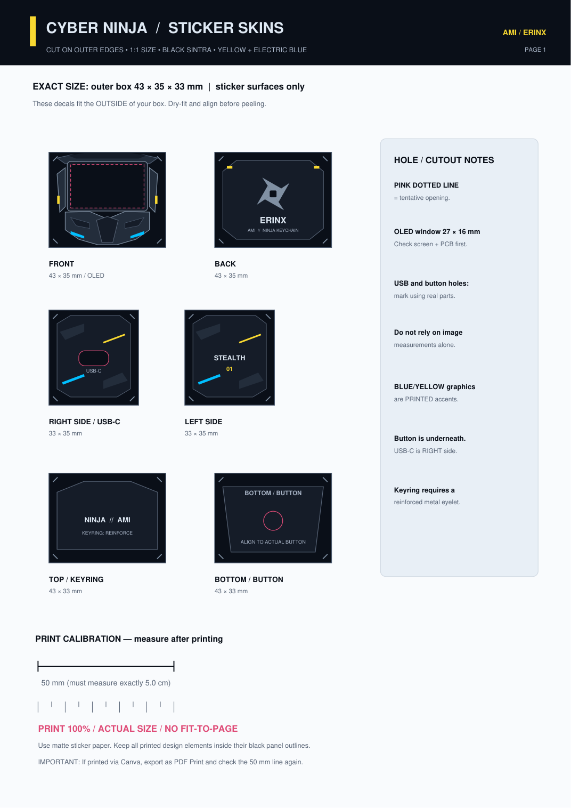

# Sintra enclosure

The enclosure is a manually cut black 3 mm Sintra (expanded PVC) box with separate, flat, angular ninja-mask decoration. The front face contains the OLED window. The USB-C access opening is on the **right**, and the tactile pushbutton opening is on the **bottom**.

## Proposed dimensions

| Dimension | External | Nominal internal clearance |
| --- | --- | --- |
| Width | 43 mm | 37 mm |
| Height | 35 mm | 29 mm |
| Depth | 33 mm | 27 mm |

Internal clearance assumes 3 mm material on opposite sides, prior to adhesive, supports, and component tolerances. These dimensions derive from a measured electronic assembly and are **proposed enclosure dimensions** until dry-fitting is complete.

## Printable assets

- [`Sticker_Sheet_A4_PRINT_100_PERCENT.pdf`](../enclosure/prints/Sticker_Sheet_A4_PRINT_100_PERCENT.pdf): cyber-ninja decorative skins.
- [`Sintra_Cutting_Template_A4_100_PERCENT.pdf`](../enclosure/prints/Sintra_Cutting_Template_A4_100_PERCENT.pdf): structural cut guide.
- [`AMI_Cyber_Ninja_Actual_Size_A4.pdf`](../enclosure/prints/AMI_Cyber_Ninja_Actual_Size_A4.pdf): combined print set.

Print on A4 paper at **100% / Actual Size** with **Fit to Page disabled**. Verify the 50 mm calibration line with a ruler before cutting. Use ordinary paper first for fit checks.

The OLED cutout, USB-C port and button openings require direct measurement and positional adjustment against the actual assembled hardware; guide shapes are not a substitute for checking connector alignment. The visual design concepts are references, not dimensionally accurate engineering drawings.

A metal keyring load should be carried through a reinforced eyelet, washer or separate metal mounting tab—not through a single thin Sintra wall. Keep the back removable and prevent battery compression or contact with adhesives and tools.

